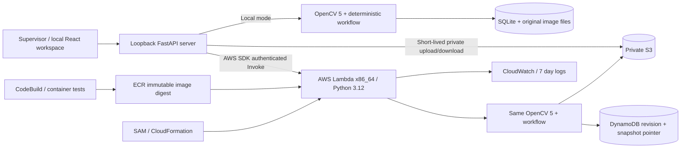

# Architecture

## Boundaries

`vision.analyze` accepts only reference bytes, current bytes and operator-defined expected positions. It has no access to missing-position labels or expected decisions. The generator and evaluator hold labels outside the prediction boundary.

`workflow` drives persisted transitions and callable tools. Analysis creates evidence; evidence quality selects rescan, no proposal or approval. Only `approve_or_reject_task` can create a task. Verification compares the original candidate IDs and preserves `physical_completion_claimed=false`.

`Repository` defines get/save/image/put_image. Local saves use SQLite optimistic revision checks. Cloud saves first write immutable JSON snapshots to S3, then atomically condition a DynamoDB pointer update on the expected revision. This avoids DynamoDB's 400 KB item limit while retaining complete event history. An unsuccessful conditional write can leave an unreferenced snapshot that expires with the bucket lifecycle. Reads support the earlier inline DynamoDB record format.

## States and recovery

`CREATED → ANALYZING → EVIDENCE_READY → APPROVAL_REQUIRED → TASK_APPROVED → VERIFICATION_PENDING → VERIFIED_VISUALLY` is the successful loop. Quality failure produces `RESCAN_REQUIRED`; rejection produces `TASK_REJECTED`; follow-up evidence can produce `UNRESOLVED` or `INCONCLUSIVE`. A processing error during analysis enters `FAILED`. A verification error enters `INCONCLUSIVE`, preserving the approval and allowing a verification retry. Concurrent stale writes return HTTP 409.

Every creation, upload, position edit, tool call and state transition records an event with time, references, measured features, previous/current state, policy rule and error type. Images get unique paths and SHA-256 metadata; replacing a capture never overwrites its original bytes. Replacing a capture invalidates its old overlay.

OpenCV `duration_ms` is measured. For other events, the current `runtime_ms=0` field is an unmeasured sentinel; it must not be interpreted as a measured zero-duration operation or included in latency claims.

## Cloud transport

The browser talks only to its loopback server. AWS credentials are loaded by Boto3 there and never enter the browser bundle. The server invokes Lambda using IAM and obtains bounded five-minute S3 upload tickets. Image downloads use a one-minute S3 ticket server-side, avoiding Lambda's payload envelope limits for full-size originals. Both the Function URL and direct Invoke require AWS authorization. A proxy failure returns 503 with no local substitution.

## Deliberate limits

This is a single-operator demo, not a multi-tenant service. The UI is not publicly hosted. Per-process request limits supplement IAM and account concurrency limits; they are not a global distributed quota. See SECURITY.md and LIMITATIONS.md.
